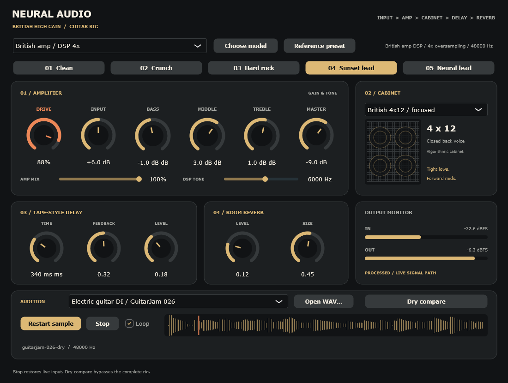
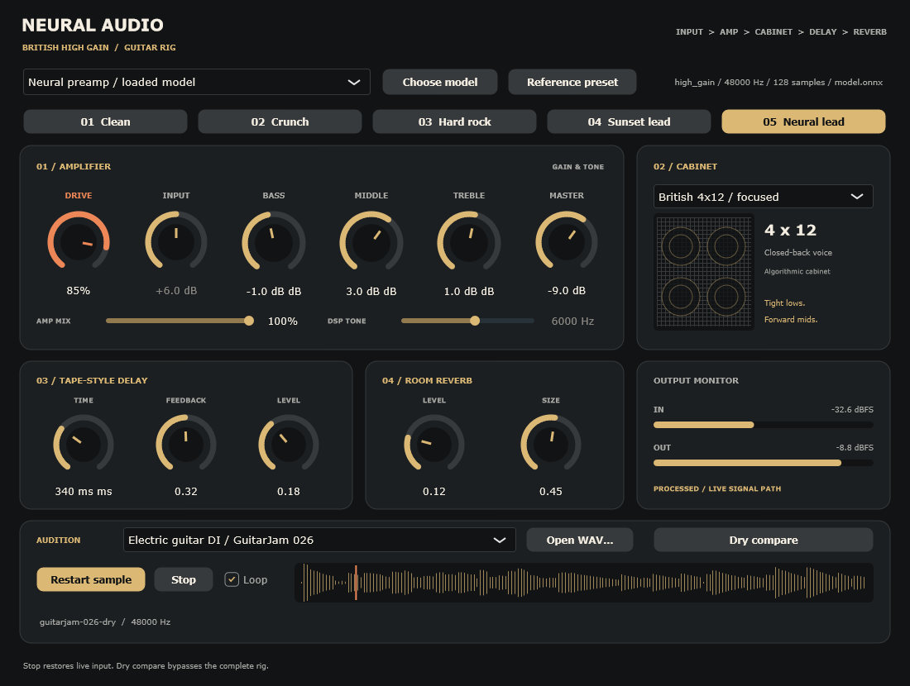

# Neural Audio Prototype

A native guitar rig and a reproducible neural-audio research pipeline. The **v5 hard-rock preview** adds a British high-gain amp, three 4x12 cabinet voicings, three-band EQ, delay, room reverb, and five gain/lead presets. A separately trained high-gain TCN is available alongside the oversampled DSP engines.



**Play locally:** run `exports\preview-v5\Launch-NeuralFX.cmd`, select **48 kHz**, and press **Play sample**. Try **Hard rock** for rhythm, **Sunset lead** for sustain and ambience, or **Neural lead** for the loaded high-gain model. **Dry compare** bypasses the complete rig with latency alignment. Selecting a different guitar clip preserves your sound.



These are screenshots of the running native editor, including live sample playback and meters. The musical direction is Marshall / Guns N' Roses inspired; the preamps and cabinets are **synthetic voicings, not hardware or artist captures**. The neural model learns the preamp only; cabinet, delay and reverb remain separate DSP. Input boost and DSP tone are disabled in neural mode to preserve the trained input contract. See the [rig controls, model contract and build instructions](docs/HIGH_GAIN.md), [tracked training configuration](experiments/high-gain.json), and [verification evidence](reports/high-gain-evidence.json). Local weights and preview binaries remain in ignored `runs/` and `exports/`; the configuration reproduces training.

The phased research pipeline is based on [the HTML research report](deep-research-report.html) and [the Markdown report](deep-research-report.md).

Open the [HTML documentation guide](docs/index.html) for [theoretical foundations and mathematical specifications](docs/THEORY_AND_MATHEMATICS.html), [metric formulas and statistical interpretation](docs/METRICS.html), and [experiments, flowcharts, and expected results](docs/EXPERIMENTS.html). Equations and flowcharts are embedded as SVG for offline viewing. These distinguish implemented behavior, measured evidence, acceptance targets, and proposed research.

Learn the foundations through the [HTML course](docs/course/index.html): twelve lessons with interactive visualizations, downloadable plots, step-by-step mathematical examples, repo exercises, worked answers, a formula sheet, and a capstone. The course works offline with local assets.

The [research production plan](docs/RESEARCH_PIPELINE.html) defines seven phases, measurable acceptance criteria, current implementation status and the remaining work. The repository supports synthetic distortion/cabinet/reverb pairs, data audits, causal Conv1D/TCN/GRU baselines, FiLM conditioning, hybrid ablations, held-out evaluation, streaming checks and export. The extension provides paired-reference control inference and native standalone/VST3 development builds; full reference-transfer and release acceptance remain open.

The [earlier electric-guitar distortion guide](docs/GUITAR_DISTORTION.html) documents v4 and its original measurements. Both previews include three publisher-declared CC0 GuitarJam DI recordings. Dry audio is processed live; effects are not baked into the supplied input recordings.

The [native preview and reference-transfer guide](docs/NATIVE_AND_REFERENCE.html) documents the implemented P4 baseline, P5 C++ renderer/recurrent exports and P6 standalone/VST3 tooling. Native parity and official VST3 conformity have been tested; paired hardware-capture evaluation, human listening and target-DAW acceptance are still pending.

The earlier v3 preview includes six [synthetic dataset samples](samples/README.md), a dedicated Drive/Mix interface, waveform, peak meters, looping playback and latency-aligned **Dry compare**. Select a sample and click **Play sample**; **Stop** restores live input. Matching DSP target WAVs are included for offline comparison. [UI/sample validation evidence](reports/ui-samples-evidence.json) records playback and packaged-host checks.

The ten-minute native timing test completed with p99 0.6912 ms, but recorded 40 processing overruns and 296 scheduling misses at 128 samples/48 kHz. Sustained acceptance failed. See [the evidence snapshot](reports/phases-4-6-evidence.json); the preview is for development and listening experiments.

## Quickstart

Python 3.11+; run from the repository root. Install PyTorch appropriate for your machine first if needed. The reference pipeline uses CPU inference/training.

```powershell
python -m venv .venv
.\.venv\Scripts\Activate.ps1
python -m pip install -e ".[dev,export]"
python -m pytest -q
python -m neural_fx run --config configs/smoke.json --output runs/smoke --export
```

To benchmark all seven architectures:

```powershell
python -m neural_fx run --config configs/smoke.json --output runs/suite --suite
```

Use a new output directory for each run. `--export` requires the export extra. Recurrent models now export explicit `hidden`/`next_hidden` ports as well as audio history. A suite can finish with exit code 1 because some models miss the declared quality or CPU budget; inspect `status.json` and `models/*/gates.json`. Tests and engineering acceptance gates serve different purposes.

If Python reports `No module named neural_fx`, install the package from the repository root using the same interpreter you use to run it:

```console
python -m pip install -e ".[dev,export]"
python -m neural_fx --help
```

The source package lives under `src/`; changing into the repository alone does not install it. Repeat installation when switching Python interpreters or virtual environments.

Without installation, set `$env:PYTHONPATH = 'src'` on PowerShell or `PYTHONPATH=src` on POSIX. In a restricted environment, direct pytest temporary files into the repository with `--basetemp runs/pytest-local` (pytest clears that directory on reuse; use it only for disposable test output).

## Individual stages

```powershell
python -m neural_fx generate --config configs/smoke.json --output data/processed/toy
python -m neural_fx verify --data data/processed/toy
python -m neural_fx train --config configs/smoke.json --data data/processed/toy --output runs/tcn
python -m neural_fx evaluate --checkpoint runs/tcn/best.pt --data data/processed/toy --output runs/tcn/evaluation
python -m neural_fx benchmark --checkpoint runs/tcn/best.pt --output runs/tcn/runtime.json
python -m neural_fx export --checkpoint runs/tcn/best.pt --output exports/tcn.onnx
python -m neural_fx render --checkpoint runs/tcn/best.pt --input path/to/mono-48k.wav --output runs/rendered.wav --drive 0.5 --mix 1
```

Change `data.effect` to `cabinet` or `reverb` in a copied config to generate deterministic IR targets. The short hybrid FIR is a prototype; long reverb modeling needs the additional work specified in the plan.

## Listening and own captures

The [data contract](data/README.md) explains the explicit capture index, signed latency and source splits. `prepare` imports it without changing signal levels.

```powershell
python -m neural_fx abx-package --evaluation runs/tcn/evaluation --output runs/listening
python -m neural_fx abx-score --answers runs/listening/private/answers.json --responses path/to/completed-responses.csv --output runs/listening/scores.json
```

Share only the `public` folder with listeners. Keep the private key with the researcher. The scorer reports per-listener descriptive binomial tests and confidence intervals; a confirmatory group study needs the protocol in the phase plan.

## Evidence and limitations

The completed P3 study and next runtime checks are interpreted in the [P3 results and P5 guide](docs/P3_RESULTS_AND_RUNTIME.html). P3 did not meet its overall acceptance criterion; cabinet quality improved against the tested TCN, while distortion improvement was unsupported and runtime acceptance failed. Keep the original analysis unchanged.

Benchmark existing nonrecurrent exports directly without retraining or PowerShell scripts:

```console
python -m neural_fx benchmark-study --plan configs/p3-study/plan.json --output runs/p5-onnx-local --iterations 2000
```

This measures ONNX Runtime CPU and PyTorch on the same active input blocks at the exported block size, verifies the saved sequence, and saves JSON/CSV comparisons. It does not export recurrent models, perform a native callback test, or change P3 acceptance. Use a fresh output directory for each profiling run.

The [next-phase guide](docs/NEXT_PHASES.html) reviews the longer `research-01` results and explains the prepared P3 study. It compares a parameter-matched conditioned TCN and the hybrid/ablations over distortion and cabinet targets with three training seeds and a fixed dataset. Start with one configuration before scheduling all 24 model fits:

```powershell
python -m neural_fx run --config configs/p3-study/distortion-seed-1337.json --output configs/p3-study/runs/distortion-seed-1337 --suite --export
```

To run the remaining study configurations, invoke `& .\configs\p3-study\run.ps1` in PowerShell. The runner skips completed configurations with matching config hashes, retains engineering gate failures, and stops for execution errors. It writes `configs/p3-study/analysis.json` with paired bootstrap comparisons and separate quality/runtime decisions. A new study can be prepared with `python -m neural_fx plan-study --config configs/research.json --output configs/another-study`.

See [the initial results](reports/INITIAL_RESULTS.md) for measured results and failed gates. Data, weights, exports and audio remain local under ignored directories; compact metric evidence is kept in `reports/`. External recordings are not bundled. Code, recordings, trained weights and plugin dependencies require separate license decisions before distribution.

The implementation includes an exploratory paired-reference control encoder, native renderer and local VST3 build. It does not establish architectural novelty, real hardware fidelity, a jointly trained reference-conditioned hybrid, listening-test indistinguishability or production readiness. Those claims require the remaining phase gates.
